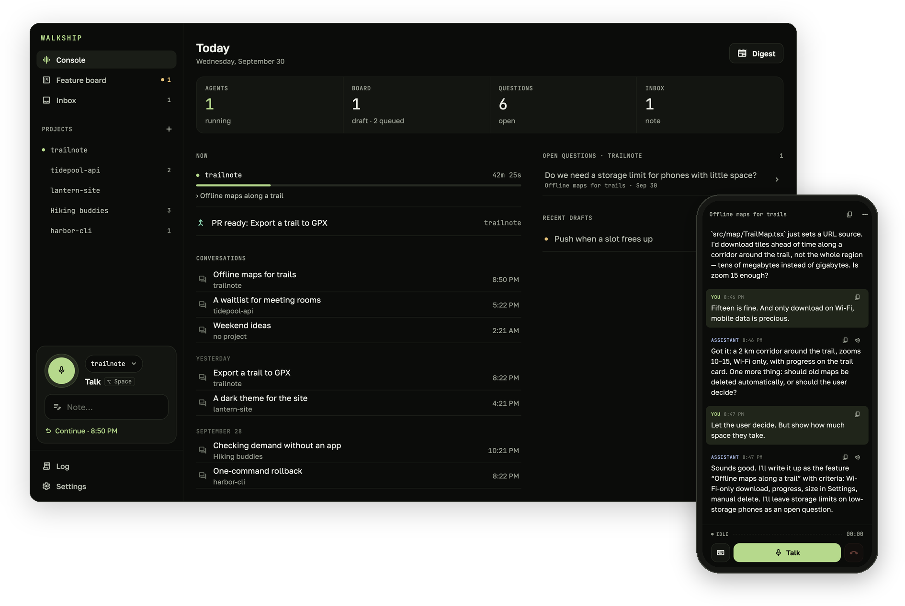
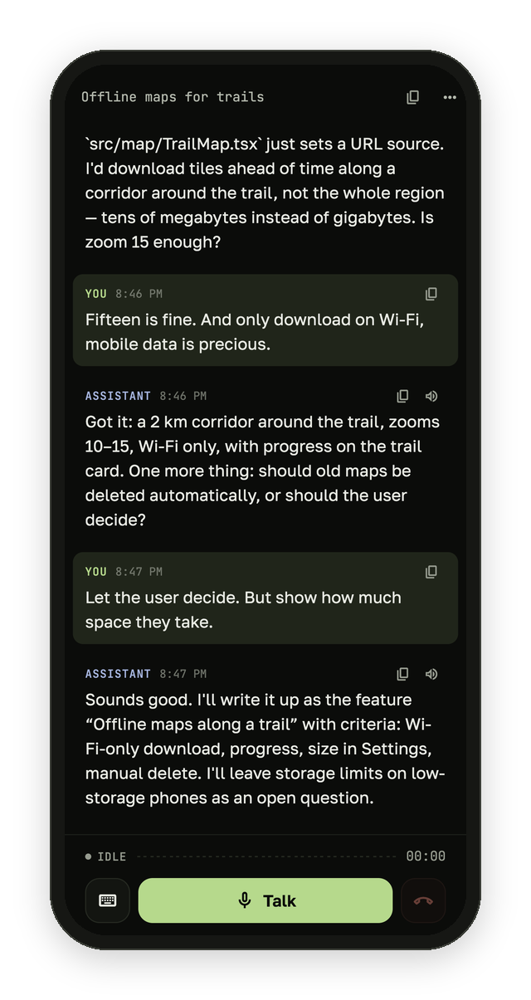
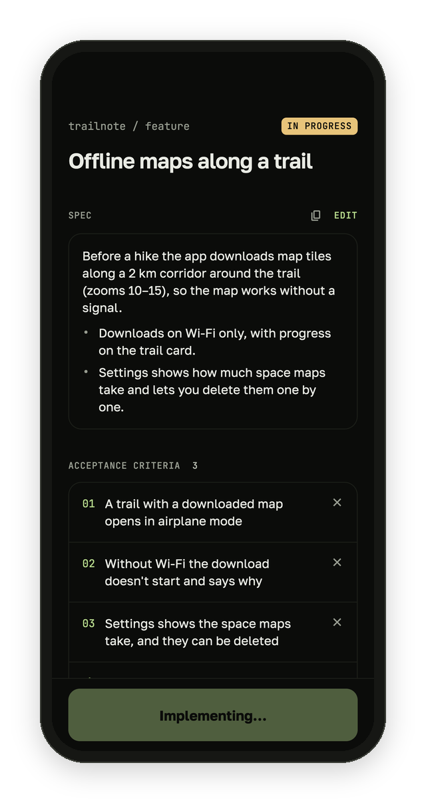
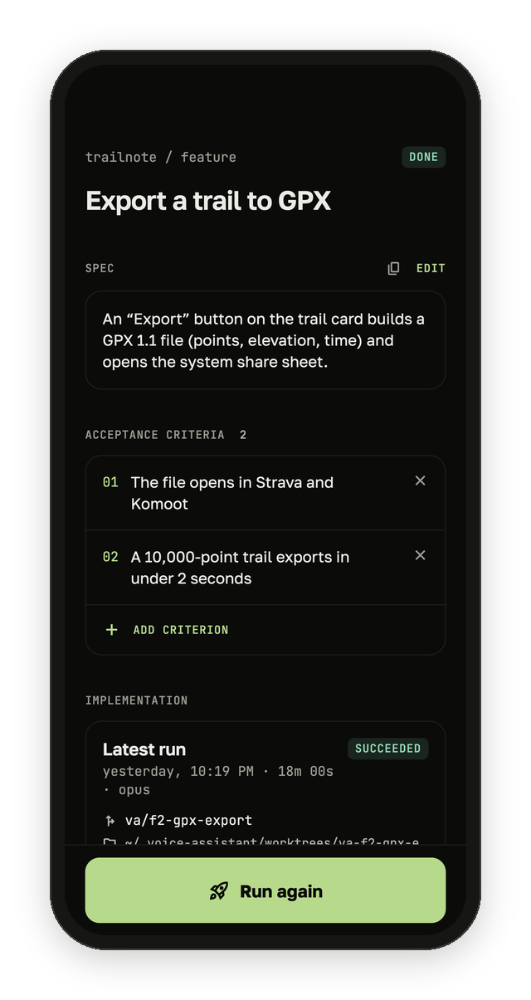
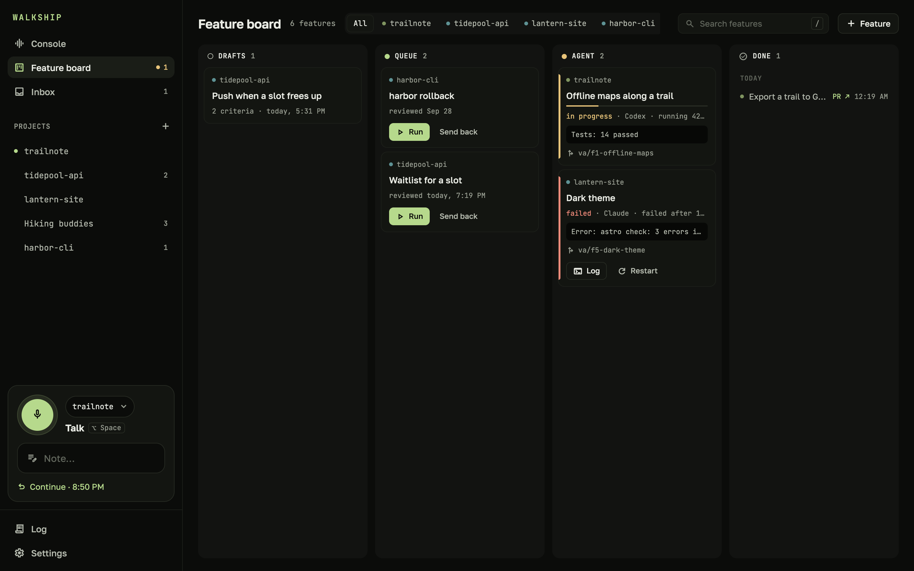
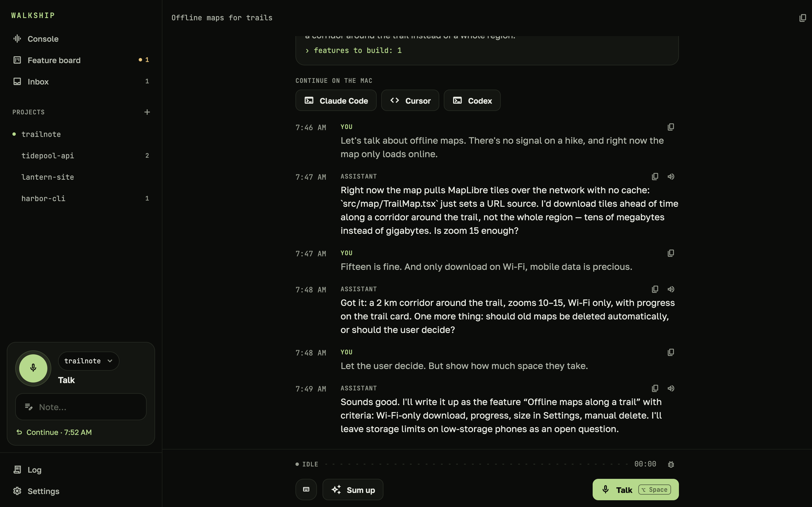
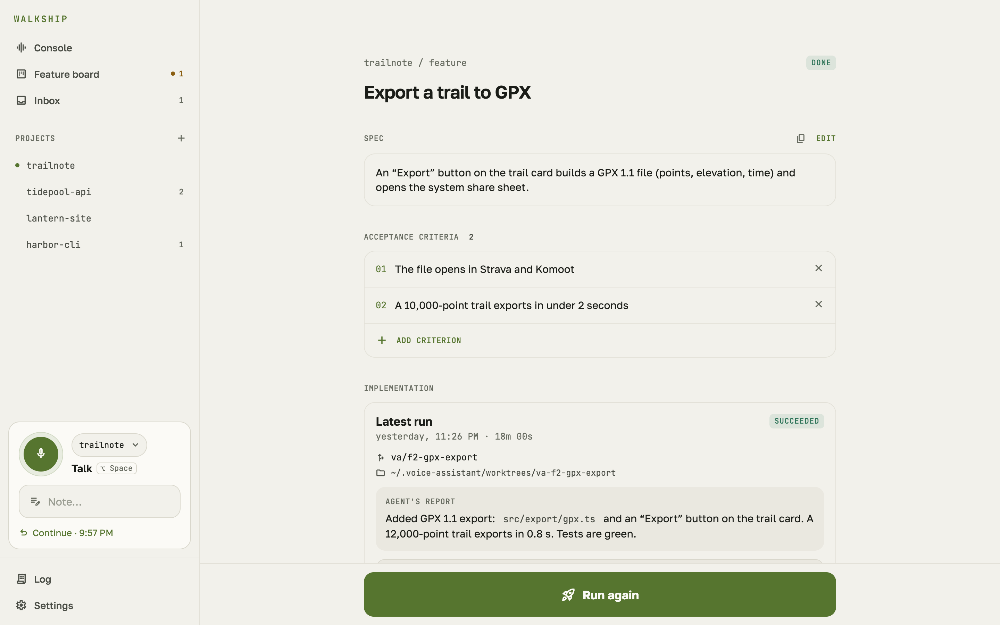
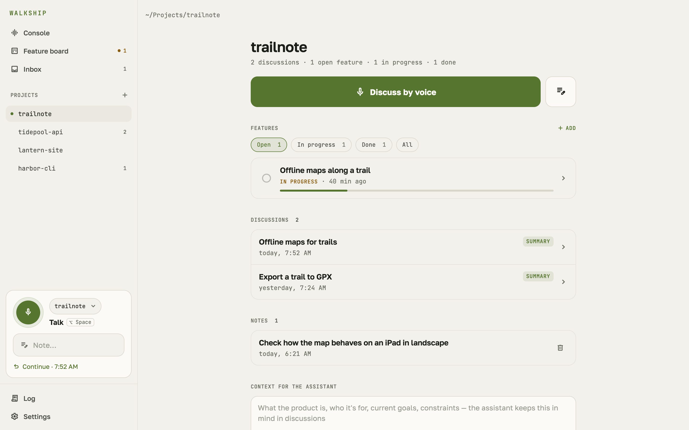

<p align="center">
  <picture>
    <source media="(prefers-color-scheme: dark)" srcset="press/logo/walkship-horizontal-on-dark.svg">
    
  </picture>
</p>

<h3 align="center">Go for a walk. Come back to a PR.</h3>

<p align="center">
  A voice partner for your projects: talk a feature through on a walk,<br>
  and Claude Code or Codex builds it on your Mac.
</p>

<p align="center">
  <a href="https://github.com/ilyabazhenov/walkship/releases/latest"></a>
  <a href="https://walkship.app/android/"></a>
  <a href="https://walkship.app/"></a>
</p>

<p align="center">
  <a href="https://github.com/ilyabazhenov/walkship/releases/latest"></a>
  
  
  
</p>

<p align="center">
  <b>English</b> · <a href="README.ru.md">По-русски</a>
</p>

<p align="center">
  <picture>
    <source media="(prefers-color-scheme: light)" srcset="press/readme/hero-en-light.png">
    
  </picture>
</p>

The best ideas rarely come at the desk. Walkship knows your code, its git history and your past discussions. Talk to
it on the go, and it turns the conversation into decisions, open questions and features with acceptance criteria.
One tap, and your coding agent builds the feature on its own branch on your Mac, runs the checks and sends a push to
your phone. Talk the result over, say "open it", and the pull request is up.

> [!NOTE]
> **Beta.** Walkship speaks English and Russian — one setting for the screens, the assistant and the voice.

## How it works

<table>
  <tr>
    <td align="center" width="33%">
      <picture>
        <source media="(prefers-color-scheme: light)" srcset="press/readme/step-en-session-light.png">
        
      </picture>
    </td>
    <td align="center" width="33%">
      <picture>
        <source media="(prefers-color-scheme: light)" srcset="press/readme/step-en-feature-running-light.png">
        
      </picture>
    </td>
    <td align="center" width="33%">
      <picture>
        <source media="(prefers-color-scheme: light)" srcset="press/readme/step-en-feature-done-light.png">
        
      </picture>
    </td>
  </tr>
  <tr>
    <td valign="top"><b>1 · You talk.</b><br>Hands-free: speak, pause, and the assistant answers out loud, then listens again.</td>
    <td valign="top"><b>2 · It sums up.</b><br>Say "wrap it up", and the conversation becomes a spec with acceptance criteria.</td>
    <td valign="top"><b>3 · An agent ships it.</b><br>Claude Code or Codex builds it in a separate git worktree and commits. A push, a spoken recap, and a PR when you say so.</td>
  </tr>
</table>

## What else it does

- **Quick notes.** Drop a thought without a conversation; the assistant files it under the right project.
- **Feature board.** Every feature of every project: drafts, queued, agent at work, done.
- **Memory.** "What did we decide about settings?" — found in past discussions of any project.
- **Digest.** One button, and you hear what agents finished, where they failed and which PRs wait.
- **Mockups.** "Show me what the screen would look like" — a sketch right in the conversation.
- **Continue on the Mac.** Open a spec or a transcript in Claude Code, Cursor or Codex with one click.
- **MCP both ways.** Your coding agents see the project's ideas and features; your own MCP servers (Jira, Sentry,
  a database) are there in conversation.

**Before the code.** A project can start without a repository: a product idea you talk over across several walks,
with memory and summaries that keep to-dos instead of features. When the repository exists, "Connect code" attaches
it, and the to-dos can go to an agent. Presets also cover a trip, a renovation, a move or an event.

**When the Mac is out of reach.** The phone can go on talking through a model with your own API key (DeepSeek or
any OpenAI-style API), remembering what the Mac knew about the project; once the Mac is back, everything moves over.

## Runs on your Mac

| What | Where it runs |
|---|---|
| **Server, database, speech, voices** | On your Mac: Whisper recognition and neural voices, data in `~/.voice-assistant` |
| **Conversation, summaries, code** | Your local Claude Code or Codex CLI — your pick for each — under your own login and subscription, no API keys |
| **Phone ↔ Mac** | Paired by QR code; directly at home, through an end-to-end encrypted relay away from it |
| **Accounts** | None, and no Walkship cloud — see the [privacy policy](https://walkship.app/privacy/) |

## Install

**You need:** a Mac with Apple Silicon and macOS 14 or later · [Claude Code](https://claude.com/claude-code) with a
Claude subscription, or Codex with a ChatGPT subscription — one is enough · about 5 GB free · git, and `gh` for
pull requests.

1. Download `Walkship-<version>-arm64.dmg` from the [latest release](https://github.com/ilyabazhenov/walkship/releases/latest)
   and drag Walkship into Applications. It's signed and notarized.
2. Open it. The setup screen walks you through signing in to Claude Code, choosing the projects folder and
   installing the voice pack (about 3.3 GB).
3. Optional, Android: install `Walkship-<version>.apk` from the same release and scan the QR code from the Mac's
   setup screen. Android asks to allow installing apps from your browser.

<details>
<summary><b>Android updates through Obtainium</b></summary>
<br>

To get new versions automatically, add Walkship to [Obtainium](https://obtainium.imranr.dev):
[add](https://apps.obtainium.imranr.dev/redirect?r=obtainium://add/https://github.com/ilyabazhenov/walkship)
(open this link on the phone) or paste `https://github.com/ilyabazhenov/walkship` into it.
</details>

The Mac app checks for updates and offers new versions from the menu bar; your data stays where it was.

## Screenshots

<table>
  <tr>
    <td></td>
    <td></td>
  </tr>
  <tr>
    <td></td>
    <td></td>
  </tr>
</table>

More, in both themes and for the phone, in [`press/screenshots`](press/screenshots).

## Releases

The newest is always on the [releases page](https://github.com/ilyabazhenov/walkship/releases/latest); every version
with its headline is in the [changelog](releases/README.md).

## Problems and feedback

[Open an issue](https://github.com/ilyabazhenov/walkship/issues/new/choose). In the Mac app, **Help → Report a
problem** saves a zip with versions, status and the server log to your Desktop; conversation texts are included only
if you tick the box. Look it over before attaching it. Security issues go privately — see [SECURITY.md](SECURITY.md).

## This repository

```text
docs/       the website, served by GitHub Pages at walkship.app
site/       the website's generator (node site/build.mjs) and the README images
press/      press kit: copy, logos, icon, screenshots, App Store listing
releases/   release notes, one file per version
```

The app's source code is not public.

<p align="center">
  <sub><a href="https://walkship.app/">walkship.app</a> · <a href="https://walkship.app/privacy/">Privacy</a> · <a href="press">Press kit</a></sub>
</p>
