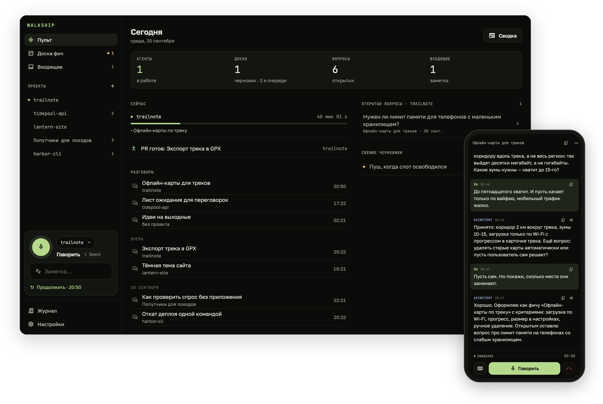
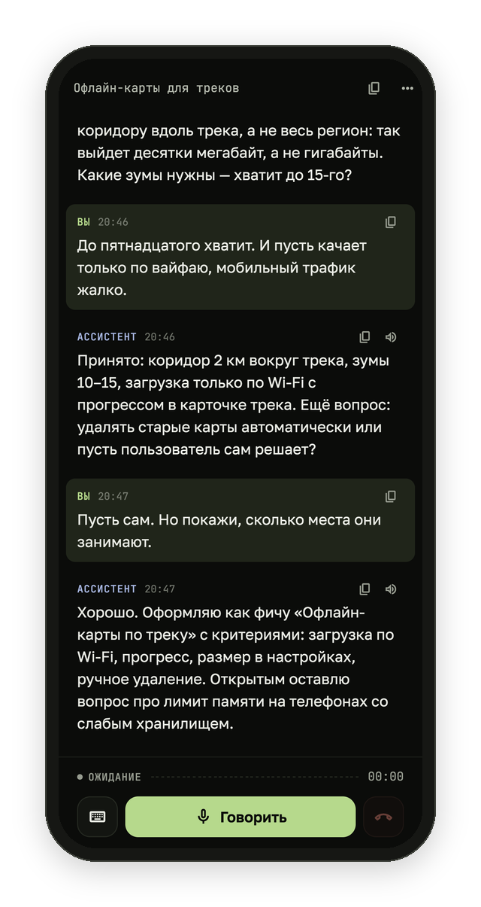
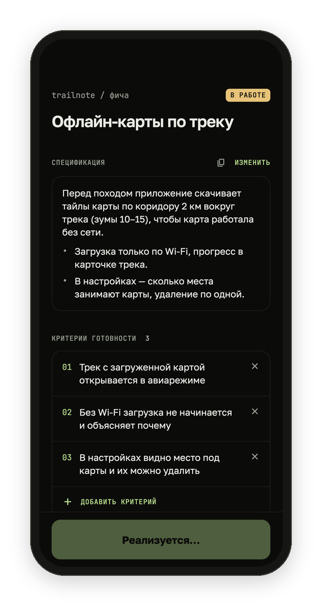
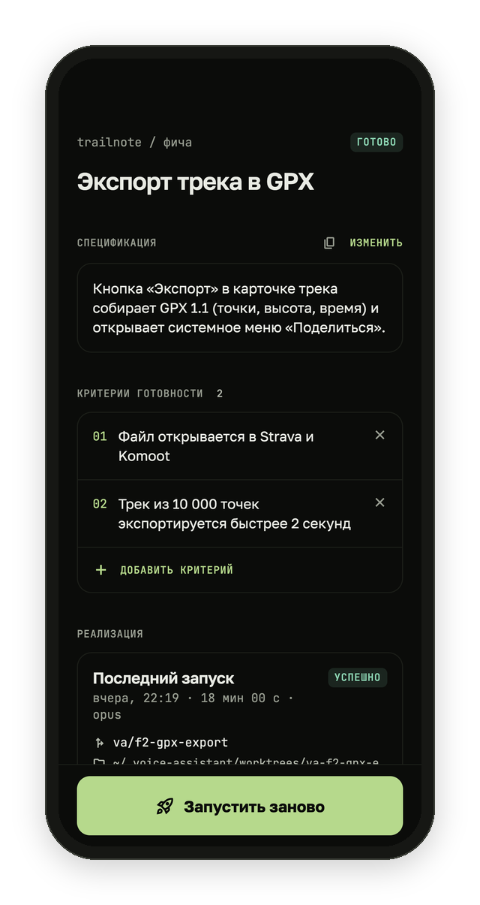
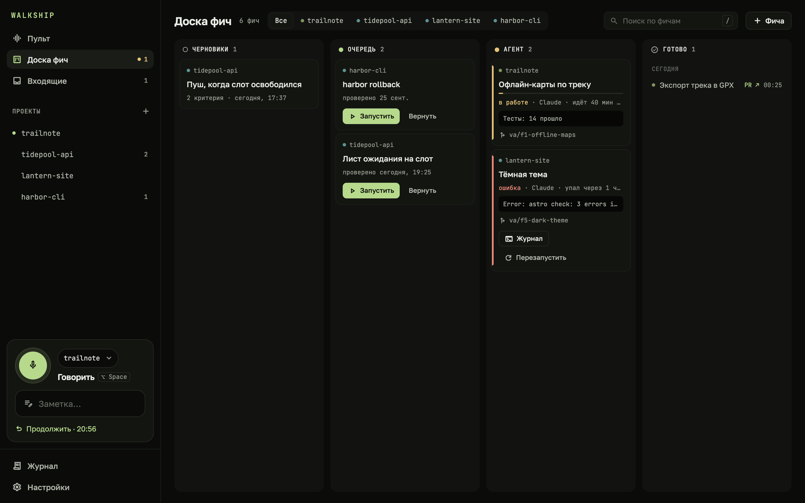
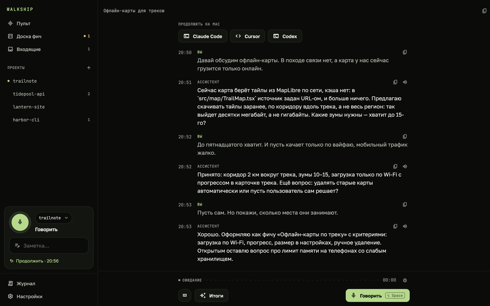
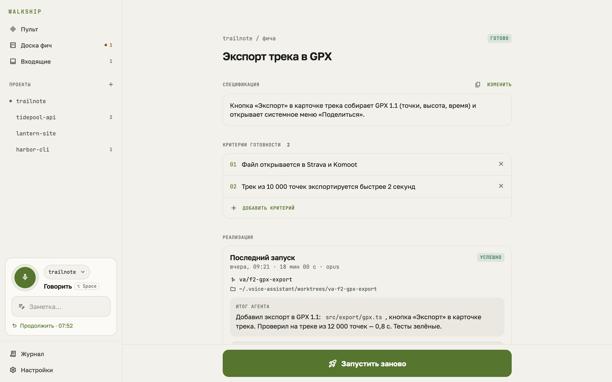
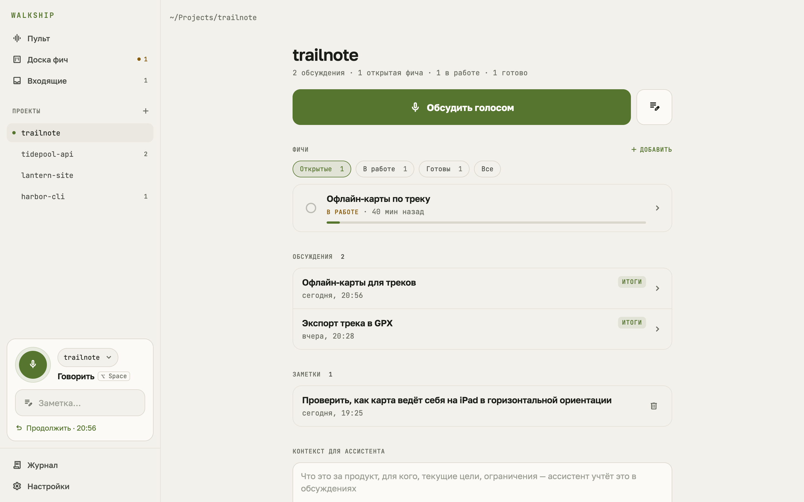

<p align="center">
  <picture>
    <source media="(prefers-color-scheme: dark)" srcset="press/logo/walkship-horizontal-on-dark.svg">
    
  </picture>
</p>

<h3 align="center">Ушёл гулять — вернулся к готовому PR.</h3>

<p align="center">
  Голосовой партнёр для твоих проектов: обсуждаешь фичу на прогулке,<br>
  а Claude Code или Codex реализует её на твоём Mac.
</p>

<p align="center">
  <a href="https://github.com/ilyabazhenov/walkship/releases/latest"></a>
  <a href="https://walkship.app/ru/android/"></a>
  <a href="https://walkship.app/ru/"></a>
</p>

<p align="center">
  <a href="https://github.com/ilyabazhenov/walkship/releases/latest"></a>
  
  
  
</p>

<p align="center">
  <a href="README.md">English</a> · <b>По-русски</b>
</p>

<p align="center">
  <picture>
    <source media="(prefers-color-scheme: light)" srcset="press/readme/hero-ru-light.png">
    
  </picture>
</p>

Лучшие идеи редко приходят за столом. Walkship знает твой код, историю git и прошлые обсуждения. Говоришь с ним на
ходу — и разговор превращается в решения, открытые вопросы и фичи с критериями готовности. Одно нажатие — и твой
агент реализует фичу в отдельной ветке на твоём Mac, прогоняет проверки и присылает пуш на телефон. Обсуждаешь
результат голосом, говоришь «открывай» — и пул-реквест готов.

> [!NOTE]
> **Бета.** Walkship говорит по-русски и по-английски — одна настройка для экранов, ассистента и голоса.

## Как это работает

<table>
  <tr>
    <td align="center" width="33%">
      <picture>
        <source media="(prefers-color-scheme: light)" srcset="press/readme/step-ru-session-light.png">
        
      </picture>
    </td>
    <td align="center" width="33%">
      <picture>
        <source media="(prefers-color-scheme: light)" srcset="press/readme/step-ru-feature-running-light.png">
        
      </picture>
    </td>
    <td align="center" width="33%">
      <picture>
        <source media="(prefers-color-scheme: light)" srcset="press/readme/step-ru-feature-done-light.png">
        
      </picture>
    </td>
  </tr>
  <tr>
    <td valign="top"><b>1 · Говоришь.</b><br>Hands-free: говоришь, после паузы ассистент отвечает вслух и снова слушает.</td>
    <td valign="top"><b>2 · Он собирает итоги.</b><br>Скажи «оформляй» — разговор превращается в спецификацию с критериями готовности.</td>
    <td valign="top"><b>3 · Агент пишет код.</b><br>Claude Code или Codex реализует фичу в отдельном git worktree и коммитит. Пуш, пересказ голосом, PR — по твоей команде.</td>
  </tr>
</table>

## Что ещё умеет

- **Быстрые заметки.** Мысль без разговора — ассистент сам найдёт ей проект.
- **Доска фич.** Все фичи всех проектов: черновики, очередь, агент за работой, готово.
- **Память.** «Что мы решили про настройки?» — найдётся в прошлых обсуждениях любого проекта.
- **Сводка.** Одна кнопка — и слышишь, что агенты закончили, где упали и какие PR ждут.
- **Макеты.** «Покажи, как будет выглядеть экран» — набросок прямо в разговоре.
- **Продолжить на Mac.** Спецификацию или расшифровку можно открыть в Claude Code, Cursor или Codex одним нажатием.
- **MCP в обе стороны.** Твои агенты видят идеи и фичи проекта; твои MCP-серверы (Jira, Sentry, база) доступны
  в разговоре.

**До кода.** Проект можно начать без репозитория: идея продукта, которую обсуждаешь за несколько прогулок, — с
памятью и итогами, где вместо фич список задач. Когда появится репозиторий, «Подключить код» привяжет его, и задачи
можно будет отдать агенту. Есть и пресеты для поездки, ремонта, переезда и события.

**Когда Mac недоступен.** Телефон может продолжить разговор через модель по твоему API-ключу (DeepSeek или любой API
в стиле OpenAI) и помнит, что Mac знал о проекте; когда Mac вернётся, всё переедет на него.

## Всё на твоём Mac

| Что | Где работает |
|---|---|
| **Сервер, база, речь, голоса** | На Mac: распознавание Whisper и нейро-голоса, данные в `~/.voice-assistant` |
| **Разговор, итоги, код** | Локальный Claude Code или Codex — для каждого свой выбор — под твоим логином и по твоей подписке, без ключей API |
| **Телефон ↔ Mac** | Подключение по QR-коду; дома напрямую, вне дома через ретранслятор со сквозным шифрованием |
| **Аккаунты** | Не нужны, облака Walkship нет — см. [политику конфиденциальности](https://walkship.app/ru/privacy/) |

## Установка

**Что нужно:** Mac с Apple Silicon и macOS 14 или новее · [Claude Code](https://claude.com/claude-code) с подпиской
Claude или Codex с подпиской ChatGPT — хватит одного · около 5 ГБ свободного места · git, для пул-реквестов — `gh`.

1. Скачай `Walkship-<версия>-arm64.dmg` из [последнего релиза](https://github.com/ilyabazhenov/walkship/releases/latest)
   и перетащи Walkship в «Программы». Он подписан и нотаризован.
2. Открой его. Экран настройки проведёт через вход в Claude Code, выбор папки с проектами и установку голосового
   пакета (~3,3 ГБ).
3. По желанию, Android: установи `Walkship-<версия>.apk` из того же релиза и отсканируй QR-код с экрана настройки на
   Mac. Android попросит разрешить установку приложений из браузера.

<details>
<summary><b>Обновления на Android через Obtainium</b></summary>
<br>

Чтобы новые версии ставились сами, добавь Walkship в [Obtainium](https://obtainium.imranr.dev):
[добавить](https://apps.obtainium.imranr.dev/redirect?r=obtainium://add/https://github.com/ilyabazhenov/walkship)
(открой ссылку на телефоне) или вставь в него `https://github.com/ilyabazhenov/walkship`.
</details>

Приложение на Mac само проверяет обновления и предлагает новую версию из строки меню; данные остаются на месте.

## Скриншоты

<table>
  <tr>
    <td></td>
    <td></td>
  </tr>
  <tr>
    <td></td>
    <td></td>
  </tr>
</table>

Остальные — в обеих темах и для телефона — в [`press/screenshots`](press/screenshots).

## Релизы

Самый свежий — всегда на [странице релизов](https://github.com/ilyabazhenov/walkship/releases/latest); все версии с
главным изменением каждой — в [истории изменений](releases/README.md).

## Проблемы и отзывы

[Создай issue](https://github.com/ilyabazhenov/walkship/issues/new/choose). В приложении на Mac **Справка → Сообщить
о проблеме** сохраняет на Рабочий стол zip с версиями, состоянием и журналом сервера; тексты разговоров попадают
туда, только если поставить галочку. Посмотри его, прежде чем прикладывать. Об уязвимостях — приватно, см.
[SECURITY.md](SECURITY.md).

## Этот репозиторий

```text
docs/       сайт, GitHub Pages на walkship.app
site/       генератор сайта (node site/build.mjs) и картинок для README
press/      пресс-кит: тексты, логотипы, иконка, скриншоты, страница в App Store
releases/   заметки к релизам, по файлу на версию
```

Исходный код приложения не публичный.

<p align="center">
  <sub><a href="https://walkship.app/ru/">walkship.app</a> · <a href="https://walkship.app/ru/privacy/">Конфиденциальность</a> · <a href="press">Пресс-кит</a></sub>
</p>
